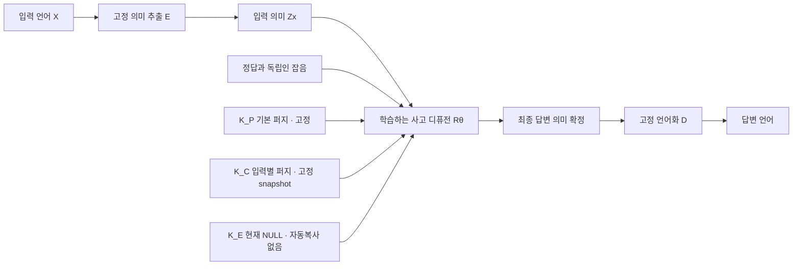

# 입력 의미에서 답변 의미를 만드는 FDT: 가능성 분석과 다음 학습 계획

2026-11-14. 최신 사람 지시를 기준으로 ROOT가 직접 작성했다. **이번 작업은 코드·과거 결과 검토, 저장 JSON 통계와 수식 계산, 원 논문 확인이다. 새 모델 forward·optimizer update·GPU 학습·타이머 재개는 없다.** 아래 학습 수치와 예산은 실제 실행된 결과와 구분한 제안이다.

## 1. 판단부터

**입력 의미와 메모리를 조건으로 디퓨전이 답변 의미를 만들고, 고정 출력기가 그 의미를 언어화하는 구조는 기술적으로 타당하며, 현재의 짧은 관계 과제에서는 실제로 시도할 근거가 충분하다.** 다만 현재 모델이 그 능력을 이미 보였다고 보고할 단계는 아니다.

현재 실패에서 특히 중요한 사실은 **출력 rank 문제를 고친 hidden520 디노이저에는 아직 정답 답변 의미 E(Y)를 표적으로 하는 학습이 한 번도 실행되지 않았다는 것**이다. 과거 V102/V105는 답변 과제를 학습했지만 수정 전 구조였고, 수정 후 V110은 입력 의미 E(X)를 되돌리는 identity 진단이었다. 이 둘을 합쳐 “수정된 답변 생성기가 충분히 학습했는데도 실패했다”고 해석하면 틀린다.

| 질문 | 현재 판단 | 근거와 남은 조건 |
|---|---|---|
| 기존 입출력을 고정하고 사고 가중치만 학습할 수 있는가? | 구현과 실제 동결 검증이 있음 | V102/V105/V109/V110에서 전체 codec·buffer 불변 확인. 새 목표에서도 같은 경계를 유지해야 함 |
| 고정 의미 공간에서 새로운 답변의 표현을 만들 수 있는가? | 제한된 범위에서 유망한 가설 | 선별 입력134개는 실제 원문 복원 가능. 기존 답변31종도 정답 문장 prefix는 읽힘. 새 답변 생성 성공은 미확인 |
| 수정된 현재 디노이저가 이 과제를 배울 가능성이 있는가? | 충분히 시험할 가치가 있음 | 알려진 출력 방향 제약 제거, 작은 유한 과제, 정확한 훈련 표적. 실제 수정 후 답변 학습은0회 |
| 지금 자료만으로 범용 LLM 역할을 얻을 수 있는가? | 근거가 없음 | 선택 자료는31개 사실·27개 답문뿐. 지식·지시 따르기·다단계 추론을 포괄하지 않음 |
| 모든 의미가 손실 없이 변환된다고 가정할 수 있는가? | 아직 가정할 수 없음 | 입력 복원 성과와 추상 의미성·표현 주변의 안정성·새 의미의 언어화는 별도 조건 |

성공 확률을 수치로 제시하지 않는다. 현재 실험으로 추정할 통계적 근거가 없기 때문이다. **단기 목표의 구현 가능성은 지지되며, 현 상태로 범용 능력을 예측하는 것은 이르다**는 것이 판단이다.

## 2. 정확한 목적: 무엇을 생성하고 무엇을 고정하는가

목표 분포는 다음과 같다.

`pθ(Z_answer | E(X), K_P, K_C, K_E)`

훈련 표적은 `Zy = E(Y)`이며, `E(X)`가 아니다. 실제 추론에서는 정답 Y나 E(Y)를 모른다. 입력 의미는 조건으로 사용하고, 정답과 독립인 잡음에서 답변 의미를 형성한 뒤 D를 호출한다. 기존 입력·메모리 형성·결합·출력의 모든 가중치와 buffer를 고정하고 **Rθ 소유 가중치만** 업데이트한다.

확률적 표현으로는 최종 언어 분포가 `∫ p_D(Y|Z) pθ(Z|E(X),K) dZ`가 된다. 실제 현재 D는 신경 점수와 UTF8 규칙으로 읽는 고정 출력 경로다. 추론 중 원문·정답·답안 검색·정답 template 조립으로 이를 대신하지 않는다.

여기서 “새 의미”는 입력을 새 말로 반복하는 데 한정되지 않는다. 질문에 맞게 관계를 뒤집거나, 여러 사실에서 결론을 만들거나, 필요한 정보를 골라 요약하는 결과 의미를 뜻한다. 다만 현재 자료는 주로 한 사실의 비교 방향·부정·질문 역전을 다루며, 아직 다단계 결론 생성 자료는 아니다. 무작위 잡음이 새로운 사실의 정당성을 제공하는 것도 아니다. 답의 근거는 입력·기억·학습에서 와야 한다.

디노이징의 시간 단계는 잡음 수준과 생성 경로의 단계다. **16단계를 돌렸다는 사실만으로 논리적16단계 사고를 수행했다고 해석하지 않는다.** 논리적 조합 능력은 그에 맞는 문제와 반례로 따로 확인해야 한다.

## 3. 기존 실험을 목표별로 다시 분류한 결과

| 분기 | 실제 표적 | 구조 | 실제 학습 | 이번 판단에서의 역할 |
|---|---|---|---|---|
| V102→V105 | 정답 답변 E(Y) | hidden256, velocity512×256 | 192+768update, 두 Adam trajectory | 실제 답변 생성의 초기 학습. 이후 발견한 rank 제약이 있었음 |
| V109 | 원래 입력 E(X) | 같은 hidden256 | 134update | 검증 입력에서도 사고 경로를 거치면 깨지는지 분리한 진단 |
| V110 | 원래 입력 E(X) | hidden520, 유효 velocity rank512 | 67update | 구조 수정 후 순수 의미 loss 경로의 초기 학습. 답변 생성 실험이 아님 |
| 다음 제안 | 정답 답변 E(Y) | 수정된 hidden520 | **아직0update** | 현재 필요한 실제 주 실험 |

서로 다른 목적·초기화·optimizer의 update를 합쳐 하나의 답변 생성기가 장기간 학습했다고 계산하지 않는다. 특히 V110의 의미 MSE2.59→2.01 감소는 identity 과제에서의 값이다. 새 답변 의미 생성의 성과나 수렴 목표로 그대로 이식할 수 없다.

기존 rank 문제는 실재했다. `vθ = W512×256 h + b`의 출력이 최소256개 직교 방향을 제어하지 못하고, 사용한16단계 VP/DDIM 경로에서 그 방향의 초기 잡음 표준편차 계수 `cos(π/32)^16 ≈ 0.925676`이 남았다. 실제 저장16개 샘플의 투영도 계산과 일치했다. hidden520 수정은 LayerNorm 이후 유효 출력 rank512를 확보했다. **이 제약을 제거한 것은 확인됐지만, 그것만으로 올바른 의미 생성이 학습되지는 않는다.**

과거 좋은 typed/given-role 관계 예측 결과는 그 분기의 유효한 성과로 보존한다. 현재 raw-text 의미 입력·새 디노이저·고정 출력기의 성능과 같은 수치라고 할 수는 없지만, 현재 실패가 그 과거 성과를 무효화하는 것도 아니다.

## 4. 현재 자료가 실제로 무엇을 제공하는가

기존 JSON을 다시 계산하고, 전체 현재480행의 비교·부정 정답을 두 대상의 유한 수치 경우로 독립 재구성했다. 새로운 모델이나 정답 생성기를 학습하지 않았다.

| 항목 | 원래 TRAIN | 엄격한 입력 왕복 통과 TRAIN |
|---|---:|---:|
| 행 |384|134|
| 서로 다른 fact key |32|31|
| pair-language group |19|19|
| 서로 다른 답변 문자열/의미 참조 |27|27|
| greater / less / unknown |128 /128 /128|38 /42 /54|
| 입력 길이 |최대120byte|56–77byte|
| 한 epoch 정답 답변 UTF8byte |6,784|2,318|
| 완전한 질문 역전짝 |192쌍|58쌍|
| 짝이 빠진 행 |0|18|

선택134개는 family0/1/2/3 각각23/31/50/30행, layout0/1은56/78행, 질문 역전 여부는67/67행이다. 엄격한 복원 선별은 codec이 잘 처리하는 길이와 표현으로 자료를 편향시킨다. 신뢰할 수 있는 시작점이지만 영어 전체의 대표 표본은 아니다.

### 4.1 입력 정보가 남아 있다는 근거는 꽤 강하다

이134개는 같은 고정 D가 의미 Commit만 받아 서로 다른 원문으로 정확히 복원했다. 따라서 이 유한 집합에서 두 서로 다른 원문이 D가 구별할 수 없는 동일한 표현으로 완전히 합쳐졌다고 볼 수 없다. 그런 경우 결정적인 동일 D가 두 원문을 각각 돌려줄 수 없기 때문이다.

**이 범위에서는 질문·사실을 담은 입력 정보가 존재한다는 근거가 있다.** 이는 새로운 답변 의미로 변환할 정보가 없어서 원천적으로 불가능하다는 해석을 약화한다. 다만 D가 원문을 읽는 능력과 두 층 사고 모듈이 필요한 관계를 쉽게 추출하는 능력은 다르다. 이 증거는 추상 의미 공간의 완성이나 미학습 문장 일반화를 보장하지 않는다.

### 4.2 상수 답변과 답문 암기를 구별해야 한다

항상 `It is unknown.`이라고 답하면 선택 TRAIN에서는 **54/134=40.30%**, 기존 각 DEV에서는 **16/32=50%**다. 그러므로 전체 정답률만 높아지는 것은 충분하지 않다. 긍정 관계80개와 unknown54개를 나누고, 개체·방향·부정·불확실성을 각각 확인해야 한다.

완전한58역전짝 중 긍정 관계를 실제로 뒤집어 답해야 하는 것은32쌍이다. 나머지26쌍은 양쪽 모두 unknown인 과제다. unknown에서도 무조건 출력이 바뀌어야 한다고 요구하면 올바른 모델을 벌주게 된다.

기존 원래 curriculum은384행·192완전짝을 가정한다. 선택134개에는18개 singleton이 있으므로 이를 그대로 호출하면 안 된다. 빠진 짝을 제외된 TRAIN/DEV에서 다시 끌어오지도 않는다. **58실제짝과18singleton을 모두 소비하는 새 순서 계약**이 필요하다. 실제짝을 batch 안에서 보존하되, 단순 scheduling 동반 행을 의미상 역전짝으로 오인하지 않는다.

### 4.3 기존 DEV가 구별해 주는 것

| 패널 | 입력 원문 중복 | 선택 TRAIN에 같은 사실 | 선택 TRAIN에 같은 답문 |
|---|---:|---:|---:|
| dev_pair32 |0|0|16/32|
| dev_surface32 |0|32/32|32/32|
| dev_position32 |0|32/32|32/32|

dev_pair의 미관측 긍정 답변16개는 기존 답문만 반복하는지 구별하는 데 도움이 된다. 반면 surface/position은 일부 TRAIN facts를 의도적으로 공유하는 표현 통제다. 세 패널 모두 이미 여러 번 관측됐으므로 새 blind benchmark로 부르지 않는다.

선택134개는 원래 입력과 정답 답변의 **원문이 모두 다르다.** 그러나 문자열이 다르다는 것만으로 새로운 추론을 증명하지는 않는다. 한 사실을 질문 순서로 표현하는 일과 여러 사실에서 새 결론을 얻는 일을 후속 과제로 구분한다.

## 5. 가능성을 좌우하는 병목과 우선순위

### 5.1 가장 먼저 해결할 것은 수정 구조와 올바른 표적의 결합이다

현재 가장 정보가치가 높은 실험은 수정된 Rθ가 `Zx→E(Y)`를 배울 수 있는지다. 이를 하기 전에 또 identity 학습을 오래 수행하거나, 다른 언어모델을 붙이거나, codec 전체를 다시 학습할 필요는 없다. 기존 source-only cache와 loss-only answer cache를 사용해 목적을 직접 검증한다.

### 5.2 정답을 섞은 훈련 상태와 실제 생성 상태의 차이

표준 조건부 diffusion 훈련에서 **정답 답변 의미 E(Y)에 잡음을 섞는 것은 정상적인 감독 방식**이다. 그것을 했다는 이유만으로 복사 과제나 추론 누수라고 판단하면 안 된다. 중요한 것은 실제 생성 때 E(Y)를 주지 않고, 입력 의미·메모리·독립 잡음만 쓰는가다.

과거 V103의 낮은-noise CE와 target-free rollout 사이에는 실제 큰 차이가 있었다. 따라서 다음 제안은 실제16단계 target-free 경로를 그대로 역전파하고 끝점에서 E(Y)와 비교한다. 작은 noisy-target VP 보조 loss는 따로 유지한다. V107/V110에 이미 있는 경로를 사용하되, 새 worker가 실제로 답변 packet을 연결하는지 검증한다. 이름만 identity에서 answer로 바꾸는 변경은 부족하다.

### 5.3 답변 표적의 언어화와 종료는 아직 완벽하지 않다

과거 V95에서 E(Y)를 직접 읽은31개 답문은 **정답 prefix31/31**, 전체 문자열 일치0/31이었다. 정답 뒤 추가 문자는1–12byte였다. 따라서 “답변 의미를 D가 전혀 못 읽는다”와 “답변 의미가 완벽히 언어화된다” 모두 맞지 않는다.

표적은2개 global slot과 local slot을 고정 capacity에 넣고, 남는 부분을 학습된 terminal 벡터로 채운다. 현재 기본 geometry는 의미35slot(2global+33local)이며 D는 별도 structural terminal patch도 읽는다. **capacity를 더 크게 잡는 것만으로 부분16byte patch 안의 올바른 EOS가 자동 보장되지는 않는다.** 실제 `target_meaning`/readout의 packing·terminal·EOS 위치를 구분해야 한다.

이 과정에서 앞선 교정 기록의 숫자 표기도 바로잡았다. **V95의 local capacity33과 V110의 전체 의미35slot을 서로 다른 용량처럼 비교해서는 안 된다. 코드상 두 분기 모두 local33+global2=35다.** 현재 확인된 것은 용량의 숫자 불일치가 아니라, 짧은 답변 E(Y)의 실제 신경 readout과 정답 EOS 위치가 맞지 않는 현상이다. 단순히33을35로 바꾸는 수정을 계획하지 않는다.

고정 D에 대해 `D(E(Y))`가 늦은 EOS를 내는 경우, θ가 E(Y)에 정확히 수렴해도 그 종료 결과를 물려받는다. 이것은 이 표적의 직접 결과에 관한 논리적 제약이며, 모델이 다른 유효 의미 표현으로 정상 EOS를 낼 수 없다는 일반적인 불가능성 증명은 아니다. **첫 주 실험에서 의미 생성과 완벽한 종료를 같은 성공 조건으로 묶지 않는 이유**다.

이 현상을 모든 의미 손실로 과장해 다시 무한 게이트를 돌리지는 않는다. 우선 직접 E(Y)와 생성한 의미를 같은 D로 읽어 **관계 내용과 종료를 별도 측정**한다. 의미가 맞고 뒤에 잡음만 붙는 경우와, 주어·목적어·방향부터 틀린 경우는 다른 문제다.

주 학습은 의미 loss만 쓴다. 이후 잠재 오차는 작지만 실제 언어화가 계속 실패한다면, 별도 실험에서 **D 가중치는 고정한 채 D를 통과하는 충실도/EOS 보조 gradient를 θ에만 주는 방법**을 검토할 수 있다. 이것은 기본 제안에 미리 섞지 않으며, codec 공동 학습으로 바꾸지도 않는다. 정답 길이로 자르거나 template로 답을 조립하는 해결책은 쓰지 않는다.

### 5.4 MSE 감소가 곧 의미 정확도 증가는 아니다

현재 답변은14/19/20byte다. 의미35slot 중 내용은 몇 slot에만 있고 나머지30/31slot은 terminal tail이다. tail과 body를 별도로 평균 내는 현 구조는 유지할 가치가 있다. 그러나 body에는 global·내용·종료가 함께 들어 있으므로 관계 방향을 결정하는 작은 차이가 평균 MSE에서 충분히 드러난다는 보장은 없다.

V110에서 TRAIN 평균 의미라는 단순 기준보다도 identity MSE가 높았던 것은 당시 기본 fit 미수렴의 증거다. **그때의1.07 기준을 새 답변 과제의 기준으로 재사용해서는 안 된다.** 새 과제의 평균 기준은 TRAIN 답변 의미만으로 한 번 계산하고, 신경 모델 재실행 없이 저장 loss와 비교하면 된다.

더 중요한 장기 문제도 있다. 한 입력에 정당한 답변이 여러 개 존재할 때 모든 잡음 샘플을 하나의 E(Y)에 강한 끝점 MSE로 맞추면, 다양성이 사라지거나 서로 다른 정답의 평균 표현으로 가는 압력이 생길 수 있다. 지금처럼 정해진 비교 답문을 쓰는 작은 결정적 과제에서는 기본 적합 검사로 유용하지만, 범용 생성 단계에는 **조건부 분포 학습(VP/score 목적)과 내용 충실도 평가**를 중심으로 재조정해야 한다. 모든 표현을 하나의 코드로 강제하는 것이 최종 설계는 아니다.

### 5.5 정확한 autoencoder가 쉬운 생성 공간을 보장하지 않는다

같은 사실을 다른 표현으로 말한 코드가 멀리 떨어져 있거나, 코드가 조금만 흔들려도 출력의 개체·부정이 바뀐다면 diffusion이 배우기 어렵다. 반대로 길이에 따라 표현이 늘어난다는 이유만으로 의미가 없다고 단정할 수도 없다. **복원 가능한 정보, 추상적 조직, 주변 오차에 대한 안정성은 서로 다른 성질**이다.

PLANNER는 autoencoder의 변환 정확도뿐 아니라 잠재 공간의 국소·분포적 부드러움을 검토하고, E/D를 고정한 다음 조건부 latent diffusion을 학습했다. 이는 조사할 방향을 뒷받침하지만, PLANNER의 수치나 구조가 현재 FDT에 그대로 적용된다는 뜻은 아니다. [PLANNER 원문, 4.1–4.2절](https://arxiv.org/html/2306.02531v2).

## 6. 세 메모리와 의미 생성의 관계

| 메모리 | 다음 학습에서 유지할 실제 역할 | 현재 자료로 입증할 수 없는 것 |
|---|---|---|
| K_P 기본 퍼지 | 고정 anchor/prior를 θ의 query로 매 단계 읽음 | 이미 인증된 거대한 사실 DB 또는 외부 지식 검색기라는 주장 |
| K_C 입력별 퍼지 | 고정 추출기로 만든 source별 long/recent snapshot을 읽음 | 여러 문서를 지속 통합하는 장기 기억이 완성됐다는 주장 |
| K_E Exact | 현재 invalid NULL, 내용·복사0. 인터페이스와 정책 유지 | 정확 복사 요청을 이미 선택·수행한다는 주장 |

입력 Zx 자체에도 이미 K_P/K_C 효과가 들어 있다. 따라서 K_C를 추가 경로에서 지워도 출력이 같다는 결과만으로 메모리 전체가 쓰이지 않는다고 판단할 수 없다. 반대로 조회 연산이 있다는 것만으로 유익한 기억 활용을 입증할 수도 없다.

후속으로 가장 구별력이 큰 과제는 **질문 의미는 같고, 허용된 기억의 사실만 다르며, 그에 따라 정답이 달라지는 paired episode**다. 예를 들어 같은 “A와 B의 관계?” 질문에 K_C가 A>B인 경우와 A<B인 경우를 각각 제공한다. 이때 실제 입력/메모리 생성 계약부터 일관되게 구성해야 한다. 기존 source에 정상 기억을 포함시킨 채 별도 경로만 뒤집는 off-distribution 시험으로 대체하지 않는다.

이 과제는 다음 단계의 새 자료 계약이다. 현재134행에 이미 구현되어 있다고 하지 않는다. Exact는 일반 의미 생성의 필수 운송로로 만들지 않으며, 미래 명시적 정확 복사 의도가 들어오는 별도 기능으로 남긴다.

## 7. 권장 실행 순서

### 단계 A — 표적 연결과 경계 확인: 연구 학습이 아니라 실제 worker 준비

- 기존134개 condition과27개 E(Y) 참조를 사용한다. DEV를 train으로 이동하거나 기존480 source screen을 다시 실행하지 않는다.
- 새 worker의 `Data.target()`은 질문 원문을 answer로 치환하던 identity 경로를 제거하고 해당 ID의 **원래 답변 의미 packet**을 읽는다. 조건과 표적 파일을 분리한다.
- 답변 target의 shape·epoch·codec SHA·terminal/labels 정렬을 확인하고, 필요한27종 직접 D 검사는 실제 worker preflight에서 한 번만 한다. 과거31종 trace와 조건이 같으면 적절한 저장 근거를 재사용한다. 검증 자체를 성능 개선으로 보고하지 않는다.
- 실제짝58쌍+singleton18개를 보존하는 유한 order를 만든다. 모든 selected row가 매 epoch 정확히 한 번 소비되고, skip도 시도·노출·cursor를 소비한다.
- 전체 codec/ALLbuffers 동결, θ만 optimizer 소유, populated Adam/scaler/전체 RNG/순서/중간 gradient/READY 복구를 확인한다. source-only 경로에 정답·정답 길이가 없어야 한다.

### 단계 B — 수정된 디노이저의 첫 답변 의미 학습: 하나의 유한 trial

**권장 주안은 V110의 수정된 hidden520 구조와 그 가중치를 warm start하되, 새 답변 과제용 fresh Adam/scaler를 쓰는 것이다.** 아주 초기라도 학습한 입력·메모리 읽기와 잡음 처리를 버리지 않기 위한 판단이며, 이 warm start가 fresh θ보다 우월하다는 실험 증거는 아직 없다. 잘못된 목표를 계속 강화하지 않도록 identity loss/identity curriculum은 포함하지 않는다. V105의256차원 가중치 일부를520차원 모델에 임의로 끼워 넣지 않는다.

첫 목표는 다음 식의 실제 조건부 생성이다.

`Z_hat = Rθ^16(Zx, K, ε)`

`L = MSE_body(Z_hat, E(Y)) + 0.05·MSE_tail + 0.1·L_VP`

이는 출발 설정이다. 계수의 최적성을 주장하지 않는다. noisy-target 보조 branch는 훈련 전용이고 실제 rollout에 정답을 공급하지 않는다. **훈련 E forward0/D forward0**, D는 학습 전·후의 최종 의미 평가에만 호출한다. 반복 벌점을 먼저 크게 추가하거나 여러 loss를 동시에 바꿔 원인 구분을 없애지 않는다. 현재 D는 과거 V7의 AR decoder가 아니므로 당시 반복 원인을 그대로 가져오지 않는다.

제안 수치는 다음과 같다.

| 항목 | 제안 |
|---|---:|
| TRAIN |기존134행, 27종 정답 의미|
| 유한 epoch |16|
| 총 행 노출 |2,144|
| 정답 답변 UTF8byte 노출 |37,088byte|
| batch |8, micro1|
| 예상 attempt |268: epoch 경계를 이어 하나의 유한 row stream으로 batch 구성할 때|
| 실제 trajectory |16step, 각 row target-free16 + VPaux1|
| LR / weight decay / clip |1e-4 / .01 /1을 출발 후보로 유지|
| 전체 TRAIN encoder / D 호출 |0 /0|
| 훈련 thought forward |36,448|
| baseline·final 평가 |TRAIN probe16 + 기존 DEV96, 각112행|
| 평가 thought / D 호출 |3,584 /224|
| 연구 trial 전체 예상 호출 |**40,256**|
| 새 호출 상한 후보 |41,000: 실제 코드 비용 검토 후에만 봉인|
| 시간 후보 |owner1,200초 / modelcut1,080초 / reserve120초|
| 저장 후보 |D: 전체1GiB, 0/중간/최종+STOP+원시 결과+임시 파일 포함|

134가8로 나누어떨어지지 않는다. epoch마다 마지막6개를 별도 update로 처리하면272attempt가 된다. **268이라는 수치는 epoch 경계를 잇는 stream에 대한 수치**이며, batch 안의 실제짝 보존을 포함한 새 order 코드에서 다시 확인해야 한다. 계획서와 실제 driver의 마지막 batch 처리가 다르면 실행 전에 바로잡는다. 어느 방식에서도 행·epoch를 되감거나 skip만큼 추가 epoch를 돌리지 않는다.

V110의 실제 CPU4threads 총204.478초와 호출 수의 단순 비례는 약637초, 즉10.6분이다. backward·checkpoint·문장 길이·다른 프로세스의 영향을 분리한 정밀 추정은 아니다. **실행시간 보장이나 특정 시각 완료 약속이 아니라 예산 검토용 추정**이다. 현재 단계는 CPU로도 유의미하게 시험할 수 있다. GPU 자원 기준을 낮추거나 외부 cloud를 쓰지 않는다.

이16epoch는 “충분한 학습량이 증명됐다”는 뜻이 아니다. 올바른 목표의 첫 진행 경향과 실제 의미 정확도를 볼 유한 작업 단위다. 134행을2,144개의 새 독립 문제 또는37KB를 범용 언어모델 pretraining이라고 부르지 않는다.

### 단계 C — 실제 답변 의미와 조건 사용을 확인

최우선 지표는 다음이다.

1. 출력이 답해야 할 **대상·관계 방향·부정·불확실성**을 정확히 전달하는가. 의미가 같은 다른 표현도 인정하고, 원문 전체 일치는 보조 지표로 둔다.
2. TRAIN의 긍정80개와 unknown54개를 나누어 상수 응답을 구별한다. 첫 probe16개만으로 TRAIN134 전체를 잘 맞춘다고 보고하지 않는다. 최초 전후 비교는16개로 비용을 고정하고, 전체 fit 선언이 필요할 때만 새 목적의 전체 TRAIN 평가를 별도 계산한다.
3. 실제 역전짝32긍정쌍에서 질문 방향에 맞게 답이 바뀌는가. unknown26쌍에서는 불필요하게 단정하지 않는가.
4. 기존 DEV에서는 unseen pair의 긍정16개와 surface/position을 구분해 보고한다. 올바른 출력이 몇 개 생겼다는 것과 일반화를 달성했다는 것은 다르다.
5. MSE/VP loss, 신경 EOS의 너무 이른/늦은 종료, UTF8, 모순되는 추가 명제, 무의미한 출력 비율을 보조 기록한다. EOS 존재만으로 답변 성공을 판정하지 않는다.

개발 목표 후보는 TRAIN에서 의미 정확도90% 이상, 긍정80개에서도90% 이상으로 먼저 안정화하는 것이다. 이 threshold는 통계적 보장이나 연구 불가능 판정선이 아니다. 실제 전체 TRAIN을 평가하지 않은 상태에서 달성했다고 하지 않는다. DEV는 처음부터 단일90% 기준으로 막기보다 **unknown 상수50%를 넘어서는 긍정 관계 일반화가 생기는지**를 먼저 본다.

checkpoint는 정해진 지점에 저장하고, 같은 DEV를 매 update마다 평가하지 않는다. 고정된 한 trial이 끝나면 저장 결과를 먼저 읽고 다음 목적을 결정한다. 형식 검사가 통과하면 의미를 보지 않고 학습을 자동 확대하거나, 목표 미달이라고 즉시 구조 전체를 실패 판정하지 않는다.

### 단계 D — 한 사실의 표현 변환에서 실제 결론 생성으로 확대

단계 B에서 입력 조건을 실제 사용하는 답변이 생긴 뒤 다음으로 넘어간다.

- **기억이 필요한 paired episode:** 같은 질문·다른 합법적 기억·다른 정답.
- **다단계 조합:** 예를 들어 A>B, B>C로부터 A>C를 답한다. 정답 결론 문장을 입력·메모리에 미리 넣지 않는다. 처음에는3–4대상 유한 세계를 독립 계산해 논리 표적을 검증한다. 만족하는 세계가 없는 모순 자료를 unknown으로 잘못 표시하지 않는다.
- **새 조합·새 개체·새 표현:** graph/이름쌍/표현 family로 묶어 split을 만들고, 동일 사실의 여러 view를 독립 문제로 세지 않는다. 원래 DEV나 E2 최종 holdout을 훈련에 넣지 않는다.
- **영어 자연문장 과제:** 문맥→적절한 후속 의미, 문서→요약 의미, 질문+근거→답 의미로 확장한다. 단순 OWT 자기복원 자료만 반복하는 것으로 답변 생성 감독이 대체되지는 않는다. 후속 corpus는 출처·권리·문서 split·노출량을 확인한다.

이 단계에서도 입력과 출력 가중치를 그대로 고정한다. 고정 E/D가 어떤 새로운 개체·내용을 읽거나 표현하지 못하는 것이 직접 확인되면, 이를 θ의 사고 실패와 나누고 별도 codec 개선 분기로 처리한다. diffusion 학습 도중 몰래 E/D를 열어 공동 학습하지 않는다.

## 8. 장문과 범용 LLM 수준을 향한 현실적인 한계

입력 codec이262KB를 복원한 것과 사고 모델이 그 전체를 사용해 새 답을 만든 것은 다르다. 현재 선택 학습 입력은56–77byte이고, DEV 최대127byte다. 현재 출력 공간도 짧은 답을 위한 고정 local capacity33이다.

입력262,144byte이면 source slot은16,386개다. 출력35slot의 한 source cross-attention은 head당 `35×16386=573,510`개 query-key 쌍을 본다. 8head·2block·16step이면 누적 약1.47억 score 쌍이다. 이는 메모리 peak나 FLOP의 완전한 산정이 아니라 주의를 기울여야 할 attention 크기다. 현재 코드는 source projection도 각 step에 다시 계산한다. 장문에서는 이 중복 비용의 검토가 필요하다.

입력만 길어지면 output-query 수가 고정된 cross-attention을 이용할 여지가 있지만, **답변 의미까지 장문으로 늘리면 output self-attention의 제곱 비용**이 추가된다. 따라서 긴 입력을 읽어 짧은 결론을 만드는 과제와 긴 답변 전체를 생성하는 과제를 나눈다. source projection/KV를 재사용하더라도 훈련 중 θ의 gradient를 끊지 않는 동등한 구현이어야 한다. 지금 이 최적화를 구현·측정한 것은 아니다.

장문 후속에는 앞·중간·끝의 수량/개체/부정, 멀리 떨어진 사실의 조합, 불필요한 문맥 삽입을 따로 측정한다. 한 번 복원이 잘됐다는 이유로 학습 범위를 넘는 사고 일반화가 확인됐다고 하지 않는다.

## 9. 결과별 다음 판단

| 다음 결과 | 가장 먼저 볼 원인 | 대응 |
|---|---|---|
| TRAIN 의미가 좋아지고 DEV도 일부 좋아짐 | 올바른 목표 학습이 작동 | 같은 구조를 유지하고 새 조합·기억필수·다단계 자료로 확대 |
| TRAIN만 좋아지고 DEV는 상수 수준 | 작은 답문/이름/표현 암기, coverage 부족 | codec 공동 학습보다 먼저 group split·대조 질문·새 조합 자료 강화 |
| 언어 내용은 맞고 뒤 잡음/EOS만 실패 | terminal/부분 patch 출력 계약 | 별도 θ-only 충실도/EOS 실험 검토. 정답 길이 crop으로 숨기지 않음 |
| 끝점 MSE는 충분히 작아졌는데 관계가 틀림 | 좌표 loss와 의미 차이의 불일치, D 민감도 | 같은 D의 직접 E(Y)와 생성 Z를 비교해 의미/출력 경계를 분리 |
| TRAIN 평균 답변 의미 수준도 못 벗어남 | 최적화·정규화·rollout·조건 학습 문제 | 현재 trial 저장곡선·gradient·noise 구간을 좁게 분석. 같은 학습을 무한 반복하지 않음 |
| 입력이나 기억을 바꿔도 같은 답 | 조건 무시 또는 task 편향 | 같은 잡음의 대조 질문/합법적 기억 paired episode로 구별 |
| 일부 입력에서 필요한 구별이 사라짐 | 고정 E 표현의 태스크 정보 부족 가능성 | 선택 집합 밖 codec 증거를 별도 조사. 전체 의미 공간 실패로 확대하지 않음 |

## 10. 선행연구가 지지하는 범위

**이 구조의 원리 자체가 비현실적이라는 근거는 없다.** 언어 autoencoder의 잠재 공간에 diffusion을 학습하고 pretrained decoder로 문장을 만드는 조건부/seq2seq 결과가 이미 보고돼 있다. [Latent Diffusion for Language Generation, NeurIPS 2023](https://papers.nips.cc/paper_files/paper/2023/hash/b2a2bd5d5051ff6af52e1ef60aefd255-Abstract-Conference.html).

PLANNER도 E/D를 고정한 상태에서 조건을 받아 잠재 표현을 만들고 나중에 언어화하는 경로를 실제 사용했다. 이는 이번 분리 학습 원칙과 맞는 선례다. 다만 해당 모델의 pretrained encoder/decoder, 부드러운 latent 구성, 자료와 규모는 FDT와 다르다. 그 결과가 현재 fuzzy Commit의 추론 성능을 보장하지 않는다. [PLANNER 원문](https://arxiv.org/html/2306.02531v2).

CoDAR는 연속 표현에서 토큰으로 읽는 변환이 병목일 수 있음을 통제 실험으로 조사하고 별도 decoder를 학습했다. 이 결과는 출력 경계도 조사해야 한다는 근거이지, 지금 고정 D를 풀어 학습하라는 요구나 “FDT는 출력기만 문제”라는 증명이 아니다. 현재 D는 CoDAR의 AR decoder와도 다르다. [CoDAR, EMNLP 2026](https://aclanthology.org/2026.emnlp-main.1007/).

DDIM은 훈련 목적과 sampling 경로/step 수의 관계를 정립한 원 연구다. 현재16step의 충분성이나 논리적 사고 능력을 보장하는 자료로 사용하지 않는다. [DDIM 원문](https://arxiv.org/abs/2010.02502).

## 11. 자원과 실행 경계

새 trial은 아직 worker·실제 plan·독립 검증·seal·launch가 없다. 위 제안은 과거 trial의 남은 시간·call·update를 재사용하는 지시가 아니다. CPU 준비·분석을 실제 학습으로 보고하지 않는다.

- C: 여유100GiB 보호를 유지한다. 이 분석 시점에는 약107.96GiB로 보호선보다 높지만, 다음 실제 시작 계약을108GiB+metadata로 정하면 수십MiB가 부족할 수 있다. 실행 직전에 확인하고, 기존 승인 범위의 닫힌 산출물 무손실 압축 등으로 여유를 마련한다. 가중치·원문·게임을 삭제하지 않는다.
- 새 checkpoint/raw는 D:를 우선 사용한다. 현 여유 약14.25GiB다. 제안1GiB 전체 출력 범위와 시작8GiB 추가 여유를 실제 계산한다. 실행 중 rotation/삭제를 하지 않는다.
- 새 θ fullstate에 optimizer·enabled scaler·모든 RNG·finite order/cursor·시도/업데이트·노출·call budget·phase·동결 digest를 보존한다. 모델 변경/새 목적에 맞는 schema를 쓰며 기존 identity fullstate를 같은 목적의 정확 resume라고 하지 않는다.
- 독립 OS owner, 첫 invoked.py 중복 검사, 모든 post-Popen 예외의 owned-tree 정리, 불확실한 종료의 UNCONFIRMED, terminal 후 전체 native/proxy 종료 확인을 유지한다. 실제 훈련 중에는 ROOT가 상세 분석을 중단하고 감독에 집중한다.
- ROOT 직접 수행, 에이전트0. fdt 타이머 삭제 상태 유지. 외부 게시·유료 cloud·E2 최종 holdout/registry 접근0.

## 12. 이번에 실제로 한 일과 다음의 구체적 결정

이번에 실제로 수행한 것은 현재 코드와 기존 결과의 목적 분리, 기존 JSON 통계 재계산,480행 유한 정답의 독립 재구성,16epoch 비용 산정, 원 논문 확인이다. 저장 근거는 `outputs/FDT_ANSWER_MEANING_FEASIBILITY_20261114_evidence/saved_analysis.json`이고 분석 자체는 약0.063초, **모델 호출0/optimizer0/tensor load0**이다.

**다음 개발의 권장 결정은 ‘수정된 hidden520 디노이저 + 고정 codec/세 메모리 + 실제 E(Y) 표적 + target-free16step 경로’의 단일 유한 답변 학습이다.** 현재134개와27개 답변 의미가 그 첫 통제 자료다. 의미 정확도를 중심으로 실제 답을 읽고, 데이터가 작다는 한계와 아직 배워보지 않은 수정 모델을 구별한다. 이 실험을 하지 않은 상태에서 실패를 단정하거나, identity 복원만 계속 학습하는 방향은 권하지 않는다.
