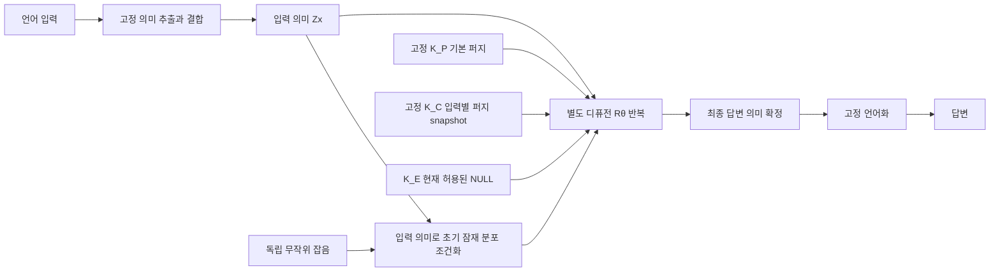

# V94 — 입출력 전체 고정, 메모리 기반 의미 디퓨전 준비

최신 지시를 반영해 **디퓨전 모듈만 학습하는 별도 후보**를 구현했다. 기존 언어·메모리·결합·출력 모듈은 학습 대상에서 제외한다. 실제 연구 모델의 디퓨전 학습은 아직 시작하지 않았다.

## 출력 퇴행의 처리

새 장문 오류3개를 만든 V91의6개 업데이트는 입출력 기준에서 제외하고, **전체 V88 가중치를 고정 codec 기준으로 선택**했다. 특정 평가 글자에 맞춰 class row를 골라 고치지 않았다. V91 가중치와 Adam/RNG·실패는 그대로 보존했다. 선택은 `configs/frozen_thought_codec_20261113_v94.json`에 기록했고 전역 모델 registry는 변경하지 않았다.

기존에 검토한 저장 결과상 장문 오류는 V91의52개에서 V88의49개/524,071byte로 돌아간다. V91에서 얻은 이름 대문자 교정1곳도 함께 포기한다. 이것은 유해한 후속 변경의 전체 회수이며, 새로운 학습으로 언어 능력이 향상됐다는 결과가 아니다. 입출력을 고정하면 사고 학습이 같은 공유 출력 분류기를 다시 바꾸는 경로도 차단된다.

기존49개 오류가 모두 해결된 것은 아니다. 장문 byte 오류율은 약0.00935%지만, 별도 숫자 스트레스64개에는 명백한 값 오류4개와 비표준 접두사8개 미인증이 남는다. 따라서 제한된 디퓨전 준비를 진행하되 codec 완성·모든 의미의 무손실 변환을 가정하지 않는다. 사고 오류와 고정 codec의 언어화 한계는 별도로 측정한다.

## 요구한 실제 경로

원문은 고정 encoder와 binding을 거쳐 입력 의미를 만든다. 디퓨전은 원문 bytes나 언어 출력 접두사를 직접 받지 않는다. 입력 의미는 초기 분포와 각 단계의 조건으로 사용한다. 메모리는 한 번 읽고 끝나는 부속품이 아니라 **각 디노이징 단계에서 현재 사고 상태의 query로 다시 읽는다.** 확정된 최종 의미만 기존 언어 출력기로 전달한다. 샘플링 도중에는 언어 출력기를 부르지 않는다.

## 초기 무작위 공간의 조건화

새 후보는 입력 의미에서 중심 `m(Zx)`와 차원별 scale `s(Zx)`를 계산한다. scale은0.5~1.5로 제한한다.

`Z_T = m(Zx) + s(Zx) · ε`, `ε ~ N(0,I)`

즉 입력 의미가 초기 무작위 잠재 분포에 영향을 준다. 추론 시 정답 의미나 정답 길이를 넣지 않는다. 초기 잡음은 명시적인 입력 tensor로 받아 seed/RNG를 실행 driver가 관리할 수 있게 했다.

학습 때만 고정 encoder가 만든 정답 답변 의미 `Zy=E(Y)`를 표적으로 쓴다. 조건부 residual의 VP 과정은 다음과 같다.

`r0=(Zy−m)/s`, `rt=α(t)r0+σ(t)ε`, `v*=α(t)ε−σ(t)r0`

예측한 v로 clean residual과 noise를 복원해 다음 시각으로 이동한다. CPU 검사에서 이 정방향·역변환 항등식을 확인했다. corruption/target 구성 쪽은 detach하고, 예측 경로만 학습한다. 목표는 v MSE와0.25 clean-meaning consistency의 후보 조합이며 최적 설정이라는 주장은 하지 않는다.

단계형 샘플링과 parameterization의 원문으로 [DDIM](https://arxiv.org/abs/2010.02502), [Progressive Distillation](https://arxiv.org/abs/2202.00512)을 확인했다. 위 입력 조건부 중심·scale 및 메모리 결합은 이번 프로젝트의 후보 설계이며, 해당 논문이 현재 FDT의 의미 성능이나16step의 충분성을 입증했다는 뜻은 아니다. 증류 학습을 실행하지도 않았다.

## 세 메모리의 역할과 동결

- **K_P:** 기존 canonical anchor와 prior를 그대로 읽는다. 새 디퓨전 query가 μ/ρ/confidence를 만들어 읽는 위치와 비중을 정한다. anchor/prior 자체는 학습하지 않는다. certified 장기 writer를 새로 만들지 않았다.
- **K_C:** 기존 입력별 long/recent N/D에서 얻은 값을 읽는다. 디퓨전의 새 gate가 두 읽기의 비중을 조절하지만 snapshot과 추출·감쇠 가중치는 수정하지 않는다.
- **K_E:** 현재 정책대로 유효 내용0인 NULL 경로다. 입력 전문·비밀번호·문장 전체를 자동으로 담거나 복사하지 않는다. 유효 Exact 내용이 넘어오면 지금 후보는 거부한다. 미래의 명시적인 모델 내부 정확 복사 의도와 permit은 별도 구현이다.

새 query/router·메모리 read projection·입력 조건부 prior·시간·refinement·velocity는 모두 **새 디퓨전 모듈 소유**다. 기존 codec의 옛 typed denoiser나21field basis를512차원 Commit에 억지로 연결하지 않는다. 원래 미사용 branch를 포함한 전체123,497,080개 codec parameter와 모든 buffer를 동결한다.

## 언어 출력은 최종 의미 뒤에만

`FinalMeaning`은 디노이징이 끝난 의미의 별도 타입이다. `sample()`에는 target이나 gold mask/length 인수가 없다. 최종 의미를 반환할 때까지 decoder 호출은0이며, `verbalize_final()`만 이를 codec Commit으로 바꿔 언어화한다.

처음 후보는 고정 output capacity 안에서 짧은 답변을 학습하도록 했다. 정답 target의 길이와 EOS 위치는 훈련 loss packet에만 있다. 기존 frozen 출력기의 terminal latent를 학습용 EOS 의미로 사용하며, 이것이 기존 구조적 terminal 계산과 같은 logit을 만드는 것을 CPU에서 확인했다. 정답 글자 조립이나 고정 문장 template은 아니다.

입력 geometry의 source cap은 기존262,144byte에 해당하는16,386개 의미 slot이다. 이 값은 새로운 장거리 사고 성능 검사 결과가 아니다. 최초 답변 target 범위는 최대512byte+EOS이며 장문 답변 디퓨전까지 검증했다고 하지 않는다.

## 디퓨전 가중치만 변경하는 실행 장치

기존 `FrozenLanguageBoundary`를 재사용한다. codec을 `requires_grad=False`와 전체 eval로 고정하고 stale gradient를 지운다. 새 thought parameter 이름과 optimizer 소유가 정확히 일치해야 하며, 기존 parameter·공유 storage·중복/교체 parameter를 거부한다.

`ThoughtOnlyUpdate`는 optimizer step 전후에 기존 codec의 parameter/buffer identity·version·mode·gradient를 검사한다. 저장 및 단계 종료 시에는 전체 digest를 대조한다. 매 update마다 고정123M 가중치를 GPU에서 CPU로 옮겨 hash하는 낭비는 피한다. version만으로 `.data` 쓰기를 완전히 감지한다고 주장하지 않으며, 전체 digest 검사가 이를 보완한다.

학습 중 frozen decoder의 미분 연산을 사용할 수는 있다. 이때 gradient는 답변 의미를 통해 디퓨전으로만 전달되고 decoder parameter gradient와 optimizer 소유는0이다. 입력·memory snapshot은 detach하되 memory read 연산 자체를 `no_grad`로 막아 query 학습까지 끊지 않는다.

## 실제 확인 범위

새 CPU 검사11개 PASS. 입력별 초기 분포 변화, VP 항등식, K_P/K_C 영향과 query gradient, Exact NULL, target 분리, 의미 확정 전 언어 호출0, 동결 위반 거부, 버전 검사와 전체 digest의 역할을 확인했다.

ROOT의 별도 작은 구조 fixture에서는 thought AdamW1회와 VP4step을 실행했다. 실제 형태의 prefix-free byte readout을 통과하는 gradient가 새 thought에 도달했고, 작은 codec의 모든 parameter/buffer와 입력 memory 값은 전후 bitwise 동일했다. 전체 후보는3,224,322parameter다.

실제 V88 모델 forward0/연구 parameter update0/GPU0, 전체123M 모델 재구성도0이다. immutable V88 source와 필수 V74 standalone의 파일 SHA를 확인했으며 가중치를 새로 쓰지 않았다. 작은 fixture 업데이트를 연구 디퓨전 학습이나 답변 능력으로 세지 않는다.

## 남은 준비

다음은 질문·입력 원문에서 만든 source 의미/읽기 전용 memory와, 정답 답변에서 만든 loss-only 목표 의미를 분리하는 자료 계약이다. 첫 task는 단순 입력 복사보다 입력의 사실·관계·부정·수량·순서를 답변 의미로 바꾸는 작업이어야 한다. TRAIN canonical split과 출처를 유지하며 관측 DEV/E2 final을 훈련으로 가져오지 않는다.

고정 codec의 `D(E(Y))` 상한과 디퓨전의 목표 의미 정확도·실제 언어 출력 정확도를 구분한다. 이 준비 뒤에 worker의 optimizer/scaler/모든 RNG/fullstate 복구, 고정 time/call/노출/출력 cap, 실제 preflight와 owned OS 감독을 갖춘 한정 thought-only 실행을 만든다. 아직 그 실행 plan·seal·GPU 학습은 없다. 하드웨어 재승인 질문을 기다리는 상태가 아니다.

구현: `research/memory_thought_diffusion_v94.py`, `research/thought_only_update_v94.py`. 증거: `research/artifacts/memory_thought_20261113_v94_cpu_v1/root_cpu_review.json`, `evidence_SHA.json`.
