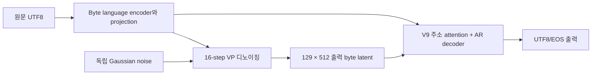

# 언어→내부 상태, 디노이징, 내부 상태→언어 재검토

**최신 사람 정의 반영:** “의미 개선”의 목적지는 입력 의미 자체의 복원/정리가 아니라, 입력 의미를 조건으로 **출력으로 삼을 특정 의미**를 디노이징해 형성하는 것이다. 주 설계는 `X→S_in→Diffusion(S_out|S_in,의도,허용기억)→언어화`다. 아래 V10 byte-alignment 후보는 보조 연구로 보존하며 주 의미 모델의 대체나 자동 다음 실행으로 취급하지 않는다. 새 주 계약은 `FDT_SEMANTIC_OUTPUT_PIPELINE_NEXT_CONTRACT_20261028_KR.md`에 정리했다.

이 검토는 최신 사람 지시인 “언어-의식 과정과 의식 디노이징, 의식-언어 과정 모두 재검토해”에 따라 ROOT가 직접 수행했다. 여기서 의식은 사용자가 정의한 내부 상태 경로의 명칭으로 다룬다. **실제 코드에서 현재 생성 분기의 latent는 미래 출력의 바이트 코드다. 독립적인 의미 연산을 끝낸 상태와 동일하다고 주장할 근거는 아직 없다.**

먼저 typed 관계/QueryCount와 V1–V9 이력, V7경계 진단, V8/V9의 실제 가중치와 결과를 읽었다. 이어 아래 1차 논문을 확인하고 현재 코드의 목표·gradient·noise를 계산했다. 검토를 위해 추가 GPU baseline이나 모델 forward를 반복하지 않았다.

## 현재 실제 경로

학습 중 clean 목표는 `sqrt(512)×fixed_codec[target_byte]`다. 의미 요소의 종류·주체·관계·부정·근거를 명시적으로 확정하는 중간 상태는 이 분기에 없다. 같은 뜻의 두 문장은 바이트가 다르면 서로 다른 목표가 된다. 출력 전에 확산이 끝나는 실행 순서는 있으나, 그 자체가 의미를 먼저 확정했다는 증명은 아니다.

## 1. 언어→내부 상태

`LiveLanguageVP.encode`는 원문 바이트를9층 causal language encoder에 넣고 마지막2층과 projection만 이전 V5–V7의 언어 학습에서 갱신했다. 앞7층/embedding/pool은 동결됐다. V8/V9의 추가3,272업데이트에서는 인코더 전체와 VP가 동결됐으므로 최근 출력부 개선을 언어 의미 해석 개선으로 볼 수 없다.

명목상 attention window48이지만9층을 거치는 한 위치의 최대 이론 receptive field는 `1+9×47=424`다. 256byte 원문보다 길고 디코더가 전체 byte context도 받으므로, 이번 문제를 “48byte밖에 못 읽어서”로 단정할 수 없다. 반대로 수용 범위가 넓다는 사실이 의미를 잘 읽는다는 증명도 아니다. 실제 원문별 조건을 이용하는 정도와 역할·부정·관계 식별은 별도 문제다.

기존 typed 관계 실험의 primary/uniform100%, oldrole1823/1824는 유효한 관측이다. 그러나 given roles/fuzzy basis와 구조화 입력을 포함한 그 경로와, 지금의 raw byte 이어쓰기 경로는 서로 다른 입력·표적 계약이다. 뛰어난 관계 결과를 지우거나 이를 raw 문서 의미 해석의 완성으로 옮겨 붙이지 않는다. 다음 의미 상태 설계는 기존 관계 연산을 보존하면서, 원문에서 누가·무엇을·어떤 관계로 말했는지를 **예측해** 연결해야 한다. Gold roles를 추론 feature에 공급하는 우회는 사용하지 않는다.

## 2. 내부 상태 디노이징

현재 VP의 표준 학습 수식 자체는 일관된다.

\[
z_t=\alpha z_0+\sigma\epsilon,\quad v^*=\alpha\epsilon-\sigma z_0,
\quad\hat z_0=\alpha z_t-\sigma v_\theta,
\quad\alpha^2+\sigma^2=1.
\]

따라서 `hat_z0-z0 = -sigma×(v_theta-v*)`이며 같은 active mask에서

\[
L_{cleanMSE}(t)=\sigma(t)^2 L_{vMSE}(t).
\]

즉 `vMSE+.25cleanMSE`는 서로 독립적인 두 의미 감독이 아니라, velocity 오차의 시간별 가중치를1에서1.25까지 바꾸는 조합이다. t=.1/.9의 clean/v 비는 .02447/.97553이다. 좋은 MSE 하나만으로 의미·관계 보존이나 문장 생성을 결론 내릴 수 없다.

`free_proposal`은16회 VP step으로 표본을 만들며 target을 받지 않는다. 이전 V5–V7의 AR손실은 이 표본을 detach한 뒤 원문 context와 함께 디코더를 훈련했다. 그러므로 AR손실은 그 표본을 만든 denoiser에 전달되지 않았다. 또한 독립적으로 뽑은 표본과 특정 정답 suffix를 무조건 짝짓는 학습은 그 상태의 내용을 무시하고 원문/언어 prior에 의존하게 만들 가능성이 있다. 이 가능성은 이력·코드와 양립하지만 그 하나만이 원인이었다고 확정하지 않는다.

V8/V9는 이를 피하려고 같은 target의 clean/noisy codec으로 연결부만 학습했다. 이제 V9에서 해당 연결부가 작동하는 것이 확인됐다. 하지만 VP는 그동안 동결됐고, 예측 상태가 그 학습 분포 안에 들어온다는 검증은 아직 없다. 현재 NLL 증가를 곧바로 “디노이저가 의미 형성에 실패했다”로 해석하지 않는다. **기존 byte 목표를 생성하는 VP의 분포와 복원 가능한 codec의 정렬**이 당장의 학습 대상이다. 16-step solver나 다른 schedule을 먼저 무한 비교하기보다 이 연결 신호를 실제로 학습시키는 편이 타당하다.

## 3. 내부 상태→언어

V7은 memory의 latent 위치 정보가 없고, 내용 교환에 둔감했다. V8은 위치 parameter를 추가했지만 clean 복원40.10%/반대 순서0/8에 그쳤다. V9는 generic index에 대한 soft address prior를 추가해, 실제 학습 뒤 held990/990와 반대 내용8/8을 복원했다. 정답 byte 내용을 원문 없이 정확히 표현할 수 있는 계약까지 진전했다.

이것은 copy 가능한 byte interface의 증거다. 추상 의미를 다양한 문장으로 표현하는 능력이나 실제 VP의 관계 추론 증거는 아니다. V9의 예측 VP 생성은 글자 혼합으로 바뀌었고, 단어 반복률0도 성공으로 세지 않는다. 반대로 기존 반복 문장이 조금 더 유창했었다는 이유로 원문에 대한 충실도가 높았다고 하지도 않는다.

현재 codec은 각 byte가 서로 직교하고 clean norm은 sqrt512≈22.6274, 다른 byte 사이 거리는32다. 연결부가 본 최대σ=.15 잡음의 기대 제곱 norm에 대응하는 RMS norm은3.3941이고 signal/noise 전력비는44.444≈16.48dB다. 실제 훈련 σ는 .15t라 대부분 이보다 작다. 이는 **작은 codec 주변 잡음**에 대한 복원 훈련이다. 자유 VP 오차도 이 범위라는 뜻은 아니다. 실제 표본의 norm·codec 투영·고잡음 예측 오차는 다음 학습의 이미 발생하는 forward에서 함께 저장하면 된다.

고정 codec readout의 이상적인 정답 확률도 `exp(8)/(exp(8)+257)≈.920629`다. Clean code가 들어왔을 때100% argmax는 의미 연산 때문이 아니라 읽을 정보가 완전히 주어졌기 때문이다. 이 구분을 앞으로도 유지한다.

## 판단과 다음 조치

전체 모델의 실패를 단언할 단계가 아니다. 현재512문서/417,443물리 UTF8bytes의 작은 합성 이야기 표본에서, 연결부와 분포를 단계적으로 학습 중이다. V9는 출력부 복원이라는 구체적인 결함을 해결했고, 실제 자유 생성에 남아 있는 다른 문제를 더 잘 관찰하게 했다.

바로 다음 V10후보는 V9디코더를 고정하고 `hat_z0`를 detach하지 않은 채 디코더 CE를 VP로 전달한다. 그 훈련 손실의 직접 원문→디코더 경로는0으로 두어 우회 학습을 막는다. Language tail은 denoiser 조건을 통해 gradient를 받는다. 같은 훈련 target에서 만든 noisy state의 denoising 표적을 사용하므로, 독립 자유 표본에 임의의 gold suffix를 강제하는 계약은 반복하지 않는다. 기존 VP vMSE/byteCE를 유지하고 frozen-decoder CE의 초기 후보 가중치는.25로 둔다. 최적값을 확인했다는 뜻은 아니다.

이는 **byte latent와 언어화 경로를 맞추는 중간 단계**다. 최종 FDT 설계는 별도로 `S*=SemanticProcess(X)`에 대상·관계·부정·근거·불확실성을 확정하고, `P(Y|S*,E)`가 그 확정된 내용을 바꾸지 않고 표현하게 해야 한다. E는 허용된 정확 기억만 포함한다. 표현 순서/어휘가 달라도 S의 사실이 유지되는 감독과, 실제로 관계를 바꾸었을 때 문장도 올바르게 바뀌는 대조가 필요하다. 기존 typed 연산을 재사용할 수 있으나, 원문의 정답 해석·평가 행을 런타임이나 train에 주입해서는 안 된다.

강한 반복 β는 별도 비교 대상으로 유지한다. 현재 글자 혼합을 반복 벌점으로 더 억제하면 비문만 다양해질 수 있다. 연결된 내용이 올바르게 전달되는 학습과 β의 효과를 섞어 성과를 주장하지 않는다.

## 확인한 1차 자료와 적용 범위

- [CoDAR 원문](https://arxiv.org/html/2603.02547v1): 연속 표현→토큰 rounding을 별도 병목으로 다루고, 작은 embedding 잡음과 contextual AR decoding을 사용한다. 현재 FDT에 특정 decoder·β·16step의 적합성을 증명하는 논문은 아니다.
- [AURORA-LM 원문](https://arxiv.org/html/2608.02602v1): 복원 가능한 표현을 먼저 만들고 그 분포를 학습하는 단계 분리, 고차원 latent의 noise 배분과 trajectory 일관성을 검토한다. 현재 byte codec을 추상 의미 표현으로 간주할 근거로 사용하지 않는다.
- [LDLM joint-training 원문](https://arxiv.org/html/2605.07933v1): encoder/latent/decoder의 목표 충돌, latent shrink와 warmup, 문맥 hidden-state 복원과 decoder noise를 분석한다. 저자들은 토큰 CE를 상류에 직접 보내지 않는 구성도 사용하므로, V10의 frozen-decoder CE는 **별도의 자체 후보**다. 이 논문은 우리의 정확한 손실이나 학습량을 보증하지 않는다.

현재 추가 구현은 `research/text_state_alignment_v10.py`와4focused CPU검사다. 실제 V9모델 state를 strict copy하고 tensor digest 동일/CPU부모 forward0/CUDA초기화false를 확인했다. **V10 worker/fullrestore/plan/seal/GPU는 아직 없다.** 모든 기존 source/core/typed weights/Adam/scaler/RNG/raw/실패는 보존했다.
